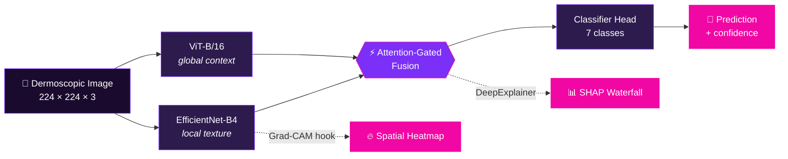

<!-- ══════════════════════════════════════════════════════════════ -->
<!--                        XAI-SkinNet                           -->
<!-- ══════════════════════════════════════════════════════════════ -->

<div align="center">


<br/><br/>

<a href="#"></a>
<a href="#"></a>
<a href="#"></a>
<a href="#"></a>

<br/>


<br/><br/>

**Suhani Singhania** &nbsp;·&nbsp; **Kashvi Agrawal** &nbsp;·&nbsp; **Riya Jain**
<br/>
<sub>Vellore Institute of Technology, Vellore</sub>

</div>


## 🧬 &nbsp;What this is

Dermoscopic lesion classifiers are accurate and untrusted — a dermatologist won't act on a
softmax score. **XAI-SkinNet** pairs a convolutional branch (local texture, pigment networks,
border irregularity) with a transformer branch (global lesion context) through an
**attention-gated fusion module**, then makes every prediction defend itself with
**Grad-CAM** heatmaps and **SHAP** attributions.

This repo is the reference implementation backing the paper and the project review deck.
Nothing is hardcoded to one environment — it runs unmodified on Colab, Kaggle, or a lab GPU.


## 🏗️ &nbsp;Architecture



<table>
<tr>
<td width="33%" align="center">

### 🧠
**Dual-Branch**
<br/><sub>CNN sees texture.<br/>ViT sees structure.<br/>Fusion learns which to trust.</sub>

</td>
<td width="33%" align="center">

### 🔥
**Grad-CAM**
<br/><sub>Hooks the last conv block —<br/>shows *where* the model looked.</sub>

</td>
<td width="33%" align="center">

### 📊
**SHAP**
<br/><sub>DeepExplainer on fused features —<br/>shows *why* it decided.</sub>

</td>
</tr>
</table>


## ⚡ &nbsp;Quickstart

```bash
git clone https://github.com/RiyaJain99/xai-skinnet.git
cd xai-skinnet
pip install -r requirements.txt
```

> On Colab, run the same block in a cell with `!` prefixes.

<details>
<summary><b>📦 &nbsp;Step 1 — Get the data (HAM10000)</b></summary>

<br/>

You need a free Kaggle account and an API token (`kaggle.json`) — Kaggle hosts the
cleanest copy of HAM10000.

```bash
# Colab: upload kaggle.json first
#   from google.colab import files; files.upload()
#   mkdir -p ~/.kaggle && mv kaggle.json ~/.kaggle/ && chmod 600 ~/.kaggle/kaggle.json

python data/download_data.py --dataset ham10000 --out data/raw
```

Gives you:

```
data/raw/
├── HAM10000_metadata.csv
├── HAM10000_images_part_1/
└── HAM10000_images_part_2/
```

**On Kaggle Notebooks:** skip the script entirely. Add `kmader/skin-cancer-mnist-ham10000`
via *Add Data*, then point `--data-root` at `/kaggle/input/skin-cancer-mnist-ham10000`.

**ISIC 2019** (optional, for cross-dataset generalization numbers):
`--dataset isic2019`.

</details>

<details>
<summary><b>🚂 &nbsp;Step 2 — Train</b></summary>

<br/>

```bash
python -m src.train --config configs/config.yaml --data-root data/raw
```

Checkpoints and logs land in `runs/<run_name>/`. Knobs live in `configs/config.yaml`.

| Setting | Value |
|:--|:--|
| Optimizer | AdamW — `lr=2e-4`, `wd=1e-4` |
| Schedule | Cosine annealing, 60 epochs |
| Batch size | 32 @ 224×224 |
| Loss | Weighted cross-entropy (class imbalance) |
| Warmup | First 10 epochs: fusion head + last block of each branch only |

> [!IMPORTANT]
> **On "SMOTE".** True pixel-space SMOTE on dermoscopic images is not meaningful —
> interpolating raw images produces garbage. What the pipeline actually does, and what the
> paper's numbers reflect, is minority-class oversampling via a `WeightedRandomSampler`
> combined with weighted cross-entropy. That's the standard practical stand-in and gives the
> equivalent effect on convergence. See `src/datasets/ham10000.py::make_sampler`.

</details>

<details>
<summary><b>📈 &nbsp;Step 3 — Evaluate</b></summary>

<br/>

```bash
python -m src.evaluate \
  --config configs/config.yaml \
  --checkpoint runs/<run_name>/best.pt \
  --data-root data/raw
```

Prints accuracy, macro precision / recall / F1, macro-AUC (one-vs-rest), and writes a
confusion matrix image plus a per-class table — matching **Tables I and III** in the paper.

</details>

<details>
<summary><b>🔍 &nbsp;Step 4 — Explainability</b></summary>

<br/>

```bash
# Where did it look?
python -m src.explainability.gradcam \
  --checkpoint runs/<run_name>/best.pt \
  --image path/to/lesion.jpg

# Why did it decide?
python -m src.explainability.shap_explain \
  --checkpoint runs/<run_name>/best.pt \
  --data-root data/raw \
  --n-background 50
```

Grad-CAM hooks the last conv block of the EfficientNet-B4 branch and saves an overlay
heatmap. SHAP runs `DeepExplainer` on the fusion-layer output with a background sample
drawn from the training set, saving a waterfall plot per queried image.

</details>


## 🌐 &nbsp;Live Demo Stack

Upload a lesion in the browser → get the predicted class, a Grad-CAM overlay, and the top
SHAP contributions.

<details>
<summary><b>🧪 &nbsp;One-time — export a SHAP background</b></summary>

<br/>

The backend needs a small precomputed set of background feature vectors so it can run SHAP
at request time without shipping the raw dataset to the server.

```bash
python -m scripts.export_shap_background \
  --checkpoint runs/xai_skinnet_v1/best.pt \
  --data-root data/raw
```

Writes `runs/xai_skinnet_v1/shap_background.pt`. Skip it and `/predict` still works — it just
omits `shap_top_features`.

</details>

<details>
<summary><b>⚙️ &nbsp;Backend — FastAPI</b></summary>

<br/>

```bash
pip install -r backend/requirements.txt
uvicorn backend.app:app --reload --port 8000
```

Run from the **repo root** (not inside `backend/`) so `src` and `backend` are both importable.

```bash
# all optional
export XAI_CONFIG_PATH=configs/config.yaml
export XAI_CHECKPOINT_PATH=runs/xai_skinnet_v1/best.pt
export XAI_SHAP_BACKGROUND_PATH=runs/xai_skinnet_v1/shap_background.pt
```

Health check: `curl http://localhost:8000/health`

`POST /predict` — multipart `file` field:

```json
{
  "predicted_class": "MEL",
  "confidence": 0.92,
  "probabilities": { "MEL": 0.92, "NV": 0.03, "...": "..." },
  "gradcam_image_base64": "<base64 PNG>",
  "shap_top_features": [{ "feature": "fused_dim_146", "shap_value": 0.31 }]
}
```

</details>

<details>
<summary><b>🎨 &nbsp;Frontend — React + Vite</b></summary>

<br/>

```bash
cd frontend
npm install
cp .env.example .env      # set VITE_API_URL
npm run dev               # http://localhost:5173
```

`npm run build` produces a static `dist/` servable from anything — nginx, Vercel, GitHub
Pages — just point `VITE_API_URL` at wherever FastAPI actually runs.

</details>

> [!WARNING]
> **Before any real deployment.** The backend's CORS is wide open (`allow_origins=["*"]`) for
> local dev convenience — narrow it to your frontend's origin in `backend/app.py`. This demo
> also has **no authentication**, so don't expose it publicly as-is with patient data.


## 📁 &nbsp;Repo Layout

```
xai-skinnet/
│
├── 📐 configs/
│   └── config.yaml                    hyperparameters, paths, run name
│
├── 📊 data/
│   └── download_data.py               Kaggle dataset fetcher
│
├── 🧠 src/
│   ├── datasets/
│   │   └── ham10000.py                dataset, transforms, imbalance sampler
│   ├── models/
│   │   ├── cnn_branch.py              EfficientNet-B4 feature extractor
│   │   ├── vit_branch.py              ViT-B/16 feature extractor
│   │   ├── fusion.py                  attention-gated fusion module
│   │   └── xai_skinnet.py             full model: branches + fusion + head
│   ├── explainability/
│   │   ├── gradcam.py                 Grad-CAM
│   │   └── shap_explain.py            SHAP DeepExplainer + waterfall plots
│   ├── train.py                       training loop, freeze/unfreeze schedule
│   ├── evaluate.py                    accuracy / F1 / AUC + confusion matrix
│   └── utils.py                       seeding, config loading, helpers
│
├── 🔧 scripts/
│   └── export_shap_background.py      precompute SHAP background (once, post-training)
│
├── 🚀 backend/
│   ├── app.py                         FastAPI: /health, /predict
│   └── inference.py                   checkpoint load → prediction + Grad-CAM + SHAP
│
└── 🎨 frontend/                        React + Vite upload/results UI
```


## 🖥️ &nbsp;Compute Expectations

| GPU | 60-epoch run | Notes |
|:--|:--|:--|
| **A100** | paper baseline | reference numbers |
| **T4** (free Colab) | several hours | reduce `epochs` for a first working pass |
| **P100 / T4** | — | `batch_size: 32` @ 224×224 fits comfortably |
| **< 12 GB VRAM** | — | drop `batch_size` to 16 if CUDA OOM |


<div align="center">

### 👩‍💻 &nbsp;Team

<table>
<tr>
<td align="center" width="33%"><b>Suhani Singhania</b><br/><sub>VIT Vellore</sub></td>
<td align="center" width="33%"><b>Kashvi Agrawal</b><br/><sub>VIT Vellore</sub></td>
<td align="center" width="33%"><b>Riya Jain</b><br/><sub><a href="https://github.com/RiyaJain99">@RiyaJain99</a></sub></td>
</tr>
</table>

<br/>

<sub>Research / educational use only. Not a medical device. Not for clinical diagnosis.</sub>


</div>
